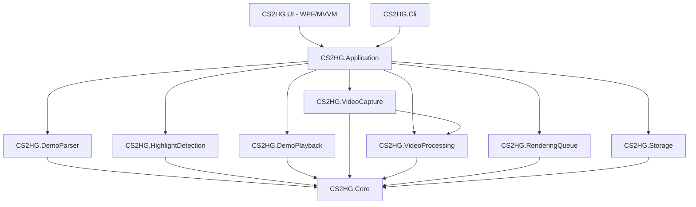

# Arquitetura

C# / .NET 10 (LTS), WPF com tema Fluent escuro, MVVM (CommunityToolkit.Mvvm), SQLite, FFmpeg.
A interface não contém regras de negócio: ela chama serviços da camada `Application`.



| Módulo | Responsabilidade | Peças principais |
|---|---|---|
| **Core** | Modelos e contratos, sem dependências | `MatchData`, `Highlight`, `RenderJob`, `AppSettings`, `IDemoParser`, `IHighlightDetector`, `IDemoPlaybackController`, `IGameRecorder`, `IVideoProcessor`, `IRenderPipeline`, `ClipPlanner`, `PovResolver` |
| **DemoParser** | Importar e ler demos | `DemoImporter` (valida `PBDEMS2`, rejeita CS:GO, descompacta `.bz2`, hash SHA-256), `DemoFileNetParser` (único lugar que conhece o DemoFile.Net) |
| **HighlightDetection** | Regras e pontuação | 19 detectores independentes, `HighlightAnalyzer` (compõe jogadas por jogador+round), `MatchAnalysis` (clutches, placar, match point) |
| **DemoPlayback** | Controlar o CS2 | `SteamLocator`, `Cs2ConfigManager` (cfgs, backup/restauração), `ConsoleLogWatcher`, `GsiListener`, `InputInjector`, `Cs2PlaybackController` |
| **VideoCapture** | Gravar o jogo | `WindowCaptureRecorder` (FFmpeg `gfxcapture`), `LoopbackAudioRecorder` (WASAPI com preenchimento de silêncio) |
| **VideoProcessing** | FFmpeg | `FfmpegLocator`/`FfmpegInstaller`, `FfmpegRunner`, `EncoderCatalog` (NVENC/AMF/QSV/x264/x265), `FfmpegVideoProcessor` (master, exportação, thumbnails, montagem), `EditPlanner`, `IVideoEffect`/`EffectRegistry` |
| **RenderingQueue** | Fila persistente | `RenderQueue`: ordem, progresso, pausa, cancelamento, deduplicação, retomada |
| **Storage** | Persistência | SQLite (`demos`, `players`, `analyses`, `highlights`, `render_jobs`), `MatchCache` (JSON gz) |
| **Application** | Orquestração | `AnalysisService`, `HighlightRenderPipeline`, `RenderService`, `MediaToolkit`, `SystemMonitor`, `AppHost` (DI) |
| **UI** | Telas | Início, Análise, Highlights, Exportar, Fila, Clipes, Configurações. Textos via `{l:Tr chave}` (troca de idioma ao vivo) |

## Fluxo de dados

```
.dem/.dem.bz2 ──DemoImporter──► .dem + hash ──IDemoParser──► MatchData ──► MatchCache + SQLite
MatchData ──HighlightAnalyzer(detectores, pontos padrão)──► Highlight[] (ordenados por pontos)
Highlight + ExportSettings ──ClipPlanner──► ClipSegment[] (ticks + POV) ──► RenderJob ──► RenderQueue
RenderJob ──HighlightRenderPipeline──► CS2 (seek/POV/resume) + captura ──► CapturedSegment[] (salvos a cada segmento)
CapturedSegment[] ──BuildMaster──► master.mp4 ──Export(título, fades)──► MP4 final + thumbnail (Work/<job> é apagado)
```

## Substituir o parser

Implemente `IDemoParser` produzindo `MatchData` e registre-o em `AppHost` no lugar de `DemoFileNetParser`.
Nenhum outro módulo referencia a biblioteca de parsing. Bibliotecas avaliadas:

| Biblioteca | Linguagem | Situação |
|---|---|---|
| **DemoFile.Net** (escolhida) | C# | CS2/Source 2 nativo, MIT, rápido (~5 s para 37 min de partida), eventos + entidades (posições, vivos, placar, convars) |
| demoinfocs-golang | Go | maduro e com suporte a CS2, mas exigiria um executável Go auxiliar e IPC |
| awpy | Python | bom para análise, exigiria runtime Python embarcado |
| demoparser (LaihoE) | Rust/Python | rápido, porém consumido via Python/Node; sem binding .NET |

## Persistência e recuperação

- Cada segmento capturado é gravado no job (`render_jobs.data`) imediatamente; um job interrompido
  (queda, fechamento, pausa) volta como *Pendente* e captura apenas os segmentos que faltam.
- Jobs com o mesmo highlight e as mesmas configurações têm a mesma `DedupeKey` e não são duplicados.
- O backup da configuração do CS2 tem um marcador `restore-pending.txt`; se o app cair com o jogo aberto,
  a restauração acontece na próxima inicialização com o CS2 fechado.

## Extensões futuras previstas

- **Efeitos** (`IVideoEffect`): já há vinheta e realce de cor; zoom automático, overlay de kill e motion
  tracking entram como novos efeitos registrados no `EffectRegistry`.
- **Música**: `EditSettings.Effects` aceita parâmetros arbitrários; a mixagem entra no grafo de áudio do export.
- **Fragmovie / montagem**: `BuildMontageAsync` já une clipes com crossfade; a seleção automática dos melhores
  highlights de várias demos é uma consulta sobre a tabela `highlights`.

## Idiomas

- Textos em `src/CS2HG.Core/Localization/<idioma>.json` (`pt-BR`, `en`, `es`), embutidos na `CS2HG.Core.dll`.
- `Localizer.Instance` guarda o idioma atual (configuração `language`; vazio = idioma do Windows) e cai para o
  inglês e depois para a própria chave quando falta uma tradução.
- Código: `L.T("chave")` / `L.F("chave", args)` (formatação com a cultura do idioma). XAML: `{l:Tr chave}`, um
  binding no indexador do `Localizer` — trocar o idioma atualiza a tela na hora; textos montados nos view models são
  refeitos por `MainViewModel.OnLanguageChanged`.
- `LocalizationTests` garante as mesmas chaves e os mesmos `{0}` nos três idiomas e que toda chave usada existe.